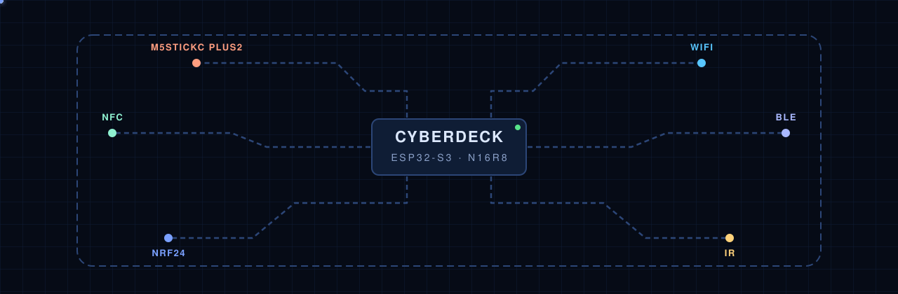
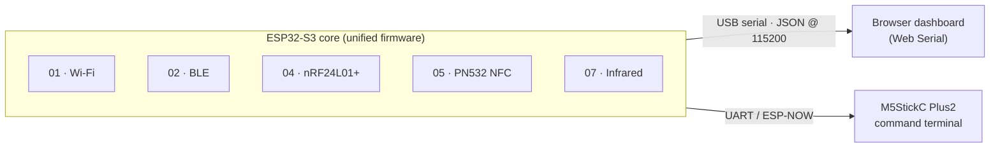

<p align="center">
  
</p>

<h1 align="center">Cyberdeck · ESP32-S3</h1>

<p align="center">
  A pocket-size, open-source field deck for wireless and physical security auditing.<br>
  One ESP32-S3 listens across Wi-Fi, Bluetooth, 2.4&nbsp;GHz, NFC and infrared, and streams every reading to a live browser dashboard.
</p>

<p align="center">
  <a href="https://rronium.github.io/cyberdeck-esp32s3/"></a>
  
  
</p>

---

## Live dashboard

**👉 [rronium.github.io/cyberdeck-esp32s3](https://rronium.github.io/cyberdeck-esp32s3/)**

The welcome page introduces the deck; **Try it** opens the dashboard. Plug the ESP32-S3 into your computer over USB, click **Connect USB serial**, pick a module and press **Start module**.

> Web Serial only works in desktop **Chrome** or **Edge**. The page talks to the board plugged into *your* computer; nothing is sent to a server.

Every push to `main` that touches `dashboard/` redeploys the site through GitHub Actions ([`.github/workflows/pages.yml`](.github/workflows/pages.yml)).

## How it fits together



The browser sends `{"module": "7.4", "action": "START"}` and the board answers with lines like `{"module": "7.4", "status": "ok", "data": {...}}`.

## Subsystems

| | Subsystem | Hardware | Status |
|---|---|---|---|
| 01 | **Wi-Fi**: scan, wardriving log, promiscuous capture, network discovery, AP hosting, frame lab | ESP32-S3 radio | ✅ Firmware + dashboard |
| 02 | **BLE**: scan, GATT services, advertisement capture, custom beacons, GATT explorer, device testing | ESP32-S3 radio | ✅ Firmware + dashboard |
| 07 | **Infrared**: 38&nbsp;kHz carrier, pulse learning, replay, protocol decode, signal analysis, LED test | 38&nbsp;kHz IR pair (RX GPIO4, TX GPIO5) | 🧪 Firmware + dashboard, hardware testing in progress |
| 04 | **nRF24**: spectrum scan, packet sniffer, address discovery, protocol analysis, packet storage, lab transmitter (4.1–4.6) | nRF24L01+ (SPI: CE&nbsp;6, CSN&nbsp;7, SCK&nbsp;12, MISO&nbsp;13, MOSI&nbsp;11) | 🧪 Firmware + dashboard, hardware untested |
| 05 | **NFC**: ISO&nbsp;14443A read, NDEF, dumps | PN532 (13.56&nbsp;MHz) | ⏳ Planned |
| — | **Command terminal**: handheld UI and IR blaster | M5StickC Plus2 | ⏳ Planned |

The CC1101 sub-GHz and RDM6300 125&nbsp;kHz modules from the original plan are out of scope for this hardware revision.

## Repository layout

```text
cyberdeck-esp32s3/
├── dashboard/                  Browser UI, deployed to GitHub Pages
│   ├── index.html              Welcome page (animated board hero)
│   ├── app.html                Dashboard: modules, telemetry table, serial console
│   └── assets/
│       ├── css/                base.css (design tokens) · welcome.css · dashboard.css
│       ├── js/                 board.js (hero animation) · dashboard.js (Web Serial + modules)
│       └── vendor/             anime.min.js
├── firmware/
│   ├── unified_firmware/       ⭐ The firmware to flash: every module behind one JSON command loop
│   ├── 01_wifi/  02_ble/       Standalone sketches, one folder per module (1.1–1.6, 2.1–2.6)
│   ├── 04_2.4ghz_nrf24/        nRF24 modules 4.1–4.6 (planned)
│   ├── 05_nfc_pn532/           PN532 modules 5.1–5.6 (planned)
│   ├── 07_infrared/            Standalone IR sketches 7.1–7.6
│   └── 00_integrated_cyberdeck_os/
├── hardware/                   3d-models/ · schematics/
├── docs/                       Documentation and README images
├── data_dumps/                 pcap_captures/ · rfid_dumps/
└── .github/workflows/          pages.yml: deploys dashboard/ to GitHub Pages
```

## Quick start

1. Open `firmware/unified_firmware/unified_firmware.ino` in the Arduino IDE, select your ESP32-S3 board and flash it.
2. Open the [live dashboard](https://rronium.github.io/cyberdeck-esp32s3/) in Chrome or Edge, or open `dashboard/index.html` locally.
3. Click **Try it → Connect USB serial**, choose the board's port, pick a module from the sidebar and press **Start module**.

---

<p align="center"><sub>Built for learning and authorized testing only. Only audit networks and devices you own or have permission to test.</sub></p>
